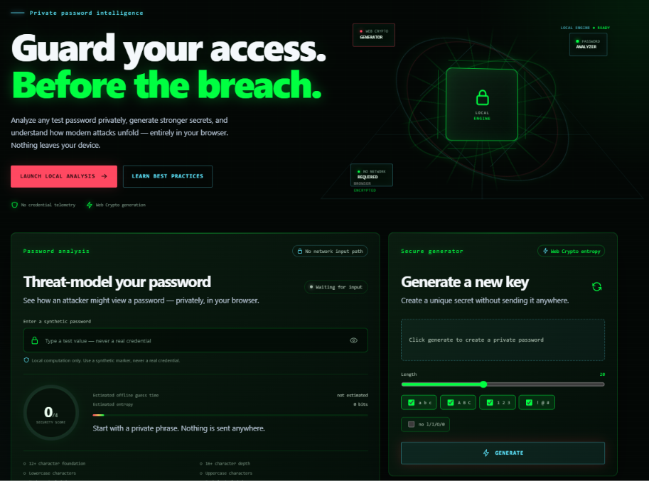

# KeyVerdict

> **Private, Zero-Knowledge Password Intelligence & Analysis Engine**



[](LICENSE)
[](.nvmrc)
[](frontend/package.json)
[](frontend/package.json)
[](SECURITY.md)

KeyVerdict is a defensive-by-design cybersecurity web application. It evaluates password strength, models modern brute-force attack vectors, provides cryptographically secure password generation, and delivers contextual security education—all with strict zero-knowledge privacy guarantees.

---

## Zero-Knowledge Privacy Architecture

```
┌─────────────────────────────────────────────────────────────┐
│                       Client Browser                        │
│                                                             │
│   [ Password Input ] ──► [ Local Scoring & Entropy Engine ] │
│                                  │                          │
│                                  ▼                          │
│                          [ Instant Verdict ]                │
│                                                             │
│   * Zero Network Requests on Keystroke                      │
│   * Zero Telemetry, Analytics, or Tracking                  │
│   * Zero Persistence (No localStorage, cookies, or session) │
│   * Works 100% Offline (Local Fallback Content)             │
└─────────────────────────────────────────────────────────────┘
```

- **Client-Side Only Evaluation**: Scoring algorithms, entropy computation, pattern detections, and dictionary lookups execute strictly within the browser runtime in JavaScript.
- **Web Crypto API**: Password generation utilizes `window.crypto.getRandomValues()` for true cryptographic randomness.
- **Zero Secret Telemetry**: No typed password, hash, fragment, or generated secret ever leaves the client machine.
- **Zero Local Persistence**: Credentials exist solely in volatile component memory and are never saved to `localStorage`, `sessionStorage`, cookies, or browser cache.
- **Offline First**: Runs completely self-contained without requiring an active internet connection or backend server.

---

## Key Features

- **Real-Time Password Analyzer**: Instant evaluation of length, character variety, predictability, repeated patterns, and common dictionary substitutions.
- **Attack Scenario Simulator**: Estimates crack times across varied attacker capabilities (online rate-limited, offline CPU, GPU clusters, and high-performance cracking rigs).
- **Cryptographically Secure Generator**: Generates customizable passphrases and high-entropy tokens using browser-native Web Crypto randomness.
- **Interactive Security Education**: Built-in library detailing modern attack threats (credential stuffing, password spraying, phishing, rainbow tables) with offline fallback data.
- **Autonomous & Offline Ready**: Runs fully standalone directly in any modern web browser.

---

## Tech Stack

- **Frontend**: React 19, Vite 7, Custom Cyber/HUD Design System.
- **Backend (Optional API)**: Express 5, Helmet, CORS, Memory Rate Limiter (serves static public educational tips and health status only).
- **Testing**: Vitest, React Testing Library, Playwright (network-isolated privacy contract validation).
- **CI Pipeline**: GitHub Actions (automated linting, testing, and security audit).

---

## Project Structure

```
KeyVerdict/
├── .github/
│   └── workflows/
│       └── ci.yml               # Automated linting, test suite, and audit pipeline
├── backend/                     # Optional minimal educational API
│   ├── src/
│   │   ├── config/              # Environment and origin validation
│   │   ├── controllers/         # Education and health endpoints
│   │   ├── data/                # Static cybersecurity guidance datasets
│   │   └── middleware/          # Security headers, rate limiting, request sanitization
│   └── tests/                   # API contract and privacy verification tests
├── frontend/                    # Core React + Vite Single Page Application
│   ├── public/                  # Static assets and icons
│   ├── src/
│   │   ├── components/          # Analyzer, Dashboard, Generator, and Education UI
│   │   ├── data/                # Offline fallback educational datasets
│   │   └── security/            # Local password scoring and entropy engine
│   └── tests/                   # Engine units and Playwright privacy boundary tests
├── .gitignore                   # Ignored files and build artifacts
├── .nvmrc                       # Node.js version declaration (v22 LTS)
├── CONTRIBUTING.md              # Community contribution guidelines
├── LICENSE                      # MIT Open Source License
├── package.json                 # Root script runner for unified local development
├── README.md                    # Project documentation
└── SECURITY.md                  # Security model and vulnerability reporting
```

---

## Quick Start (Offline / Local Development)

### Prerequisites

- [Node.js](https://nodejs.org/) v22 LTS or newer
- [npm](https://www.npmjs.com/) v10 or newer

### 1. Clone & Install

```bash
git clone https://github.com/ParadoxPusher/KeyVerdict.git
cd KeyVerdict
npm run install:all
```

*(Alternatively, you can navigate into each folder and run `npm install`)*

### 2. Run the Application

To start the frontend application locally:

```bash
npm run dev
```

Open your browser to `http://localhost:5173`. The application is fully functional offline without needing any backend.

### 3. (Optional) Run the Educational Backend

If you wish to run the supplementary educational API:

```bash
npm run dev:backend
```

The backend server listens on `http://localhost:3000`.

---

## Quality & Privacy Verification

Run the test and verification suites locally:

```bash
# Run all frontend and backend tests
npm test

# Run code style and lint checks
npm run lint

# Build the frontend for production
npm run build
```

Individual package checks can also be executed:

```bash
# Frontend only
cd frontend
npm test -- --run
npm run lint
npm run build

# Backend only
cd backend
npm test -- --run
npm run lint
```

---

## Security Policy

For full details on our zero-knowledge boundary and vulnerability reporting procedures, please review [SECURITY.md](SECURITY.md).

---

## License

This project is open-source software licensed under the [MIT License](LICENSE).
